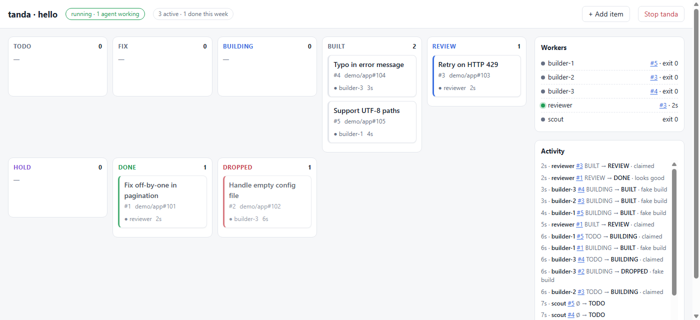
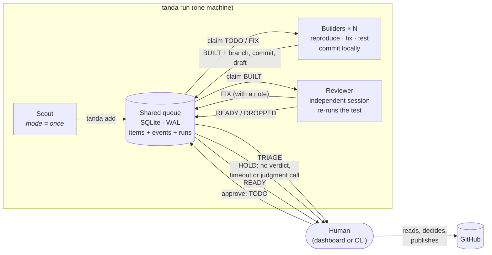
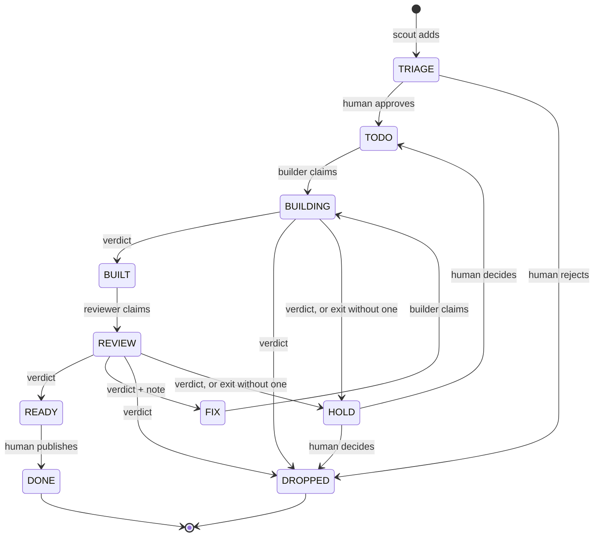

# tanda

**Run a fleet of coding agents around one shared SQLite queue, with a strict review gate and a human who decides what ships.**

[](pyproject.toml)
[](pyproject.toml)
[](LICENSE)


> **Public prototype.** tanda is the cleaned-up, general version of the multi-agent pipeline I run every day to contribute fixes to open-source AI tooling ([case study](docs/case-study-oss.md)). The in-house system moves faster; the generic parts are synced here every two weeks. Last sync: 2026-11-03.

## The problem, and what tanda does about it

Coding agents are good at small, well-defined fixes. Running several of them at once usually goes wrong in a few predictable ways: two agents grab the same task, nobody checks the work before it reaches a maintainer, idle agents burn tokens polling for work, and volume grows until maintainers start ignoring you.

tanda puts **one queue** in the middle and lets agents talk to it only through a small CLI:

- a **scout** finds candidates and adds them to the queue,
- **builders** claim items one at a time, reproduce, fix and test,
- an **independent reviewer** (a separate session) approves the work or sends it back,
- a **human** triages what goes in and publishes what comes out.

A *tanda* (Spanish for a shift or a batch) is one run. It ends on its own once the queue is drained.



## Key features

| | |
|---|---|
| **Any agent CLI** | Presets for Claude Code, opencode (which reaches Grok, DeepSeek and many other providers) and Codex, or any command that takes a prompt. You can pick a different agent and model per role. |
| **One shared queue** | SQLite in WAL mode (`.tanda/queue.db`). Claims are atomic (`BEGIN IMMEDIATE`), so two workers never get the same item. Every state change is written to an event log. |
| **Role permissions** | Each role declares the states it `claims`, the state it holds an item in (`working`) and the only `verdicts` it may set. The CLI refuses anything else. |
| **HOLD by default** | An agent that exits, crashes or times out without a verdict puts its item in `HOLD` for a human. Nothing is silently lost or retried. |
| **No idle token burn** | Waiting happens in Python, not inside an agent. An agent process starts only when there is an item for it, and exits after its verdict. |
| **Volume limits** | `group_cap` caps active items per group (for example per `owner/repo`), `blocked_groups` skips orgs entirely, and items with the same group and ref are deduplicated. |
| **Local dashboard** | `tanda ui` gives you a board per state, live workers, an activity feed, item history and agent logs, plus buttons to triage, resolve a HOLD, or mark an item done. |
| **Zero dependencies** | Python 3.11+ standard library only: `sqlite3`, `tomllib`, `http.server`, `subprocess`, `threading`. |

## Architecture



By convention, agents don't touch the database directly (tanda doesn't prevent it). They get a rendered prompt and a few environment variables (`TANDA_ROLE`, `TANDA_WORKER`, `TANDA_ITEM`, `TANDA_CONFIG`), and they report back with `tanda set` / `tanda add`. In the `oss-contrib` example **no agent writes to GitHub**: builders commit locally and draft the PR text, and the human publishes.

## How a run works

### States

States come from your `tanda.toml`: every role's `claims`, `working` and `verdicts`, plus `extra_states`. `DONE`, `DROPPED` and the hold state (`HOLD` unless you change `hold_state`) always exist. This is the `oss-contrib` flow:



### Claims

A worker role loops. It claims the best item in one of its `claims` states (lowest `priority` first, then oldest), moves it to its `working` state and records itself as owner, all in one transaction. Then it starts the agent with the role prompt plus the item (`{item_id} {title} {group} {ref} {kind} {note} {fields}`). With `count = 3` you get three of these loops in parallel. A role with `mode = "once"`, such as a scout, runs one time per tanda and adds items instead of claiming them.

### Verdicts

The agent finishes by giving exactly one verdict:

```bash
tanda set 42 BUILT --note "off-by-one in cursor; test added" \
  --field branch=fix/pagination --field commit=3f2a9c1 --field draft=drafts/42.md
```

The CLI refuses a verdict that isn't in the role's `verdicts`, and refuses any change to an item the agent does not currently hold. Fields are merged into the item, so the reviewer sees the builder's branch, commit and draft.

### HOLD

When the agent process exits and its item is still in the `working` state (no verdict, a crash, or a kill after `timeout_minutes`), tanda moves the item to `HOLD` with a note that points to the log. Agents can also choose `HOLD` themselves when a human has to decide: a design choice, a CLA, a repro only the human can observe. tanda doesn't wait on `HOLD`, so the run still ends and the items stay on the board for you.

### When a run ends

`tanda run` exits with one of three reasons:

- `drained`: every `once` role has finished and no item is left in a claimed, working or `wait_states` state;
- `stopped`: `tanda stop` or the button in the UI was used, and workers finished their current item first;
- `timeout`: `max_hours` passed.

## Quick start

```bash
pip install git+https://github.com/pcbeingused333/tanda   # Python 3.11+, no dependencies
```

### 1. The hello demo: a fake agent, so no API keys and no tokens

```bash
mkdir demo && cd demo
tanda init hello
tanda ui          # open http://127.0.0.1:8787
tanda run         # in a second terminal
```

The fake scout adds five items, two fake builders build them (and drop about one in six), and the fake reviewer approves most and sends some back with `FIX`. Watch items move across the board, then try:

```bash
tanda status      # counts per state + latest agent runs
tanda list        # active items
tanda show 1      # one item with its full history
```

### 2. The oss-contrib pipeline: real agents, real repos

```bash
mkdir oss && cd oss
tanda init oss-contrib
$EDITOR tanda.toml prompts/*.md     # pick agents and models, set limits
tanda ui &
tanda run
```

1. The scout (`mode = "once"`) looks for verified, unclaimed bugs in healthy repos and adds them to `TRIAGE`.
2. **You triage** in the dashboard, moving items to `TODO` or `DROPPED`. The run stays alive while anything is in `TRIAGE`, because `wait_states = ["TRIAGE"]`.
3. Three builders reproduce, fix, add a failing-then-passing test, commit locally and write a PR draft.
4. The reviewer re-runs the test itself, checks value, diff size, repo rules, duplicates and the draft, then sets `READY`, `FIX`, `DROPPED` or `HOLD`.
5. **You read every `READY` item, publish it yourself**, and mark it `DONE`.

Agents run non-interactively, so they need permission to run commands without asking. With Claude Code, set this in the project's permission settings (permission mode or allowed tools), and keep it as narrow as the work allows.

### Configuration at a glance

```toml
[tanda]
name = "oss-contrib"
initial_state = "TRIAGE"     # where `tanda add` puts new items
wait_states = ["TRIAGE"]     # keep the run alive while these are non-empty
extra_states = ["READY"]     # states no role claims but humans use
max_hours = 6
# poll_seconds = 5 · hold_state = "HOLD" · db = ".tanda/queue.db"

[limits]
group_cap = 5                # max active items per group (e.g. per repo)
blocked_groups = ["some-org/"]  # prefix match, case-insensitive

[roles.builder]
agent = "opencode"           # preset: claude | opencode | codex, or your own [agents.x]
model = "deepseek/deepseek-chat"
count = 3
claims = ["TODO", "FIX"]
working = "BUILDING"
verdicts = ["BUILT", "DROPPED", "HOLD"]
prompt = "prompts/builder.md"
timeout_minutes = 60

[agents.mine]
cmd = ["my-cli", "--model", "{model}", "{prompt}"]
```

| preset     | command                                 |
|------------|-----------------------------------------|
| `claude`   | `claude -p --model {model} {prompt}`    |
| `opencode` | `opencode run --model {model} {prompt}` |
| `codex`    | `codex exec --model {model} {prompt}`   |

Only the `claude` preset has been tested end to end. Check your CLI's flags and model names (for example `opencode models`) before a long run.

## Results from the in-house system

tanda is the public core of a pipeline I run daily. That in-house system uses the same design (queue + verdicts + review gate + HOLD), and it has produced:

| As of 24 Nov 2026, since August 2026 | |
|---|---|
| Pull requests **merged by maintainers** | **1,737** |
| Repositories | **405** |
| Merged PRs in repositories with **>10k stars** | **310** |

Every merge is listed in the [Merge Log](https://portfolio-alexgonzalez33.vercel.app/). Per-run metrics (merge rate, cost per published PR) and the decisions they drove are in the [case study](docs/case-study-oss.md).

These numbers belong to the in-house system, not to tanda v0.1 as published. The private parts (repo registry, per-repo state, prompts tuned to my targets, the moderator and follow-up roles) are not in this repo.

**The quality bar behind them:**

- **Small changes.** One bug, one root cause, the smallest diff in the repo's own style.
- **Tests on nearly every PR.** A test that fails without the fix and passes with it.
- **AI involvement disclosed** in neutral wording in every PR description.
- **A human decides what to target** and what gets published.

The work focuses on the bugs AI tooling keeps hitting: breakage from LLM provider and API changes, concurrency bugs in async code, and serialization problems.

## Design principles

1. **Triage before build.** Building a fix and then dropping it was the most expensive mistake in the in-house runs, so candidates are verified before a builder touches them.
2. **A strict, independent reviewer.** An independent reviewer (separate session) runs the builder's test itself. In the `oss-contrib` prompt, no test that fails on `main` means no `READY`.
3. **Volume limits.** Maintainers notice volume long before they notice quality. That's why `group_cap`, `blocked_groups` and dedup exist.
4. **Respect AI policies.** The example scout skips repos whose CONTRIBUTING or AGENTS file rejects AI-assisted contributions.
5. **Agents never write to GitHub.** They commit locally and draft. A human reads, decides and publishes.
6. **HOLD for a human by default.** When in doubt, or on any failure, the item stops and waits for a person.
7. **No idle token burn.** Agents only exist while there is work for them.
8. **Boring infrastructure.** One SQLite file, one process, the standard library. Easy to read, easy to debug.

## Limitations

This is a working v0.1 prototype. Know these before you rely on it:

- **One machine only.** The queue is a local SQLite file and there's no distributed worker support.
- **`tanda stop` does not interrupt a running `once` role.** The run waits until the scout exits.
- **The dashboard has no authentication.** Keep it on `127.0.0.1`.
- **Role permissions are a guardrail, not a sandbox.** They're enforced through `TANDA_ROLE` in the agent's environment, so an agent that runs arbitrary shell commands could get around them. Isolation (worktrees, containers, narrow agent permissions) is up to you.
- **The review gate lives in prompts.** tanda enforces *who* may set `READY` and from which state. That the reviewer actually re-ran a failing test is the reviewer prompt's job, not code.
- **No cost or token accounting yet.** `runs` records start, end, exit code and log path only.
- **Only the `claude` preset has been tested end to end.**
- **The prompt is passed as one command-line argument**, so very long prompts can hit OS argument-length limits, especially on Windows.

## Roadmap

Small, incremental, and without giving up zero dependencies. See [docs/roadmap.md](docs/roadmap.md) for the full list.

- `tanda check`: validate `tanda.toml` (unreachable states, missing prompt files, unknown agents) before a run
- `tanda report`: per-run metrics from the event log (throughput, FIX loops, HOLD reasons, time in state)
- CI on Python 3.11–3.13 for Linux, macOS and Windows
- Optional per-run cost capture from agent CLIs that report usage
- Interrupt `once` roles on `tanda stop`
- More examples: a single-repo bug-bash and a docs-fix pipeline

## Project layout

```
tanda/
  cli.py        # every command: init, add, set, show, list, count, run, stop, status, ui
  config.py     # tanda.toml loader, agent presets, state derivation
  store.py      # SQLite queue: items, events, runs, meta; atomic claim; guards
  runner.py     # role loops, prompt rendering, HOLD on missing verdict, finish condition
  ui.py, ui.html  # stdlib HTTP dashboard
  examples/
    hello/        # fake agent, runs offline
    oss-contrib/  # the open-source contribution pipeline
tests/test_tanda.py
docs/case-study-oss.md
```

## Contributing

Issues and small PRs are welcome. Read [CONTRIBUTING.md](CONTRIBUTING.md) first: the rules are no new dependencies, a test with every behavior change, and disclosure if an agent helped.

This project was built with heavy help from Claude Code, the same way it is meant to be used.

## License

[MIT](LICENSE)
