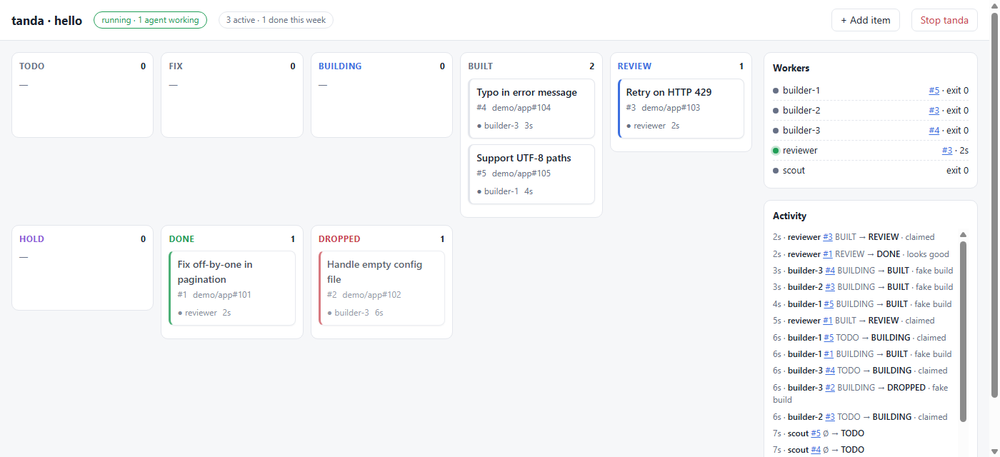

# tanda

Run a small fleet of coding agents around **one shared queue**, with a **review gate** and a **local dashboard**.

A *tanda* (Spanish for a shift or a batch) is one run: a scout fills the queue, builders take items one at a time, a reviewer approves or sends work back, and the run stops by itself when the queue is drained. Waiting is done by tanda, not by the agents: an agent only starts when there is an item for it and exits when it has given its verdict, so idle roles cost no tokens.

It works with any agent CLI that takes a prompt and can run shell commands: Claude Code, opencode (which reaches Grok, DeepSeek and many other providers), Codex, or your own command. You can mix them: a cheap model for builders, your strongest one as reviewer.



## Quick start

```bash
pip install git+https://github.com/pcbeingused333/tanda   # Python 3.11+, no dependencies
mkdir demo && cd demo
tanda init hello        # a demo with a fake agent: no API keys, no tokens
tanda ui                # open http://127.0.0.1:8787
tanda run               # in another terminal
```

For real work, `tanda init oss-contrib` gives you a pipeline for contributing to open source (below). Edit `tanda.toml` and the prompts in `prompts/`.

## How it works

- **Items** sit in a SQLite queue (`.tanda/queue.db`). Each one has a state, a title, an optional group (`owner/repo`) and ref (issue number), a priority, free-form fields, and a full history.
- **Roles** are defined in `tanda.toml`:
  - `mode = "once"` roles (like a scout) run once per tanda and add items with `tanda add`.
  - worker roles have `claims` (states they take), `working` (the state while they hold an item) and `verdicts` (the only states they may set). `count` starts several in parallel.
- An agent gets its role prompt plus the item, and reports with `tanda set <id> <VERDICT> --note ... --field key=value`. tanda refuses verdicts outside the role's list and moves on items the agent does not hold. An agent that exits without a verdict puts its item in **HOLD** for a human.
- `tanda run` ends when every `once` role has finished and nothing is left in a state some worker claims, holds, or that you listed in `wait_states`. `tanda stop` (or the button in the UI) asks workers to finish their current item and exit. `max_hours` is a hard ceiling.

```toml
[roles.builder]
agent = "opencode"
model = "deepseek/deepseek-chat"
count = 3
claims = ["TODO", "FIX"]
working = "BUILDING"
verdicts = ["BUILT", "DROPPED", "HOLD"]
prompt = "prompts/builder.md"
```

Prompt files can use `{item_id} {title} {group} {ref} {kind} {note} {fields}`.

## Any model

| preset     | command                                       |
|------------|-----------------------------------------------|
| `claude`   | `claude -p --model {model} {prompt}`          |
| `opencode` | `opencode run --model {model} {prompt}`       |
| `codex`    | `codex exec --model {model} {prompt}`         |

Your own: `[agents.mine] cmd = ["my-cli", "--flag", "{model}", "{prompt}"]`. Only the `claude` preset has been tested end to end so far; check your CLI's flags and model names (`opencode models`) before a long run.

Agents run non-interactively, so they need permission to run commands without asking. With Claude Code, set that in your settings (permission mode or allowed tools) for the project directory. Keep it as narrow as the work allows.

## The dashboard

`tanda ui` serves a board on `127.0.0.1` with one column per state, the live workers, an activity feed, each item's history and agent logs. You can add items and move any item to any state from it: that is how a human triages, resolves a HOLD, or marks something done. It has no authentication; keep it on localhost.

## Contributing to open source without burning maintainers out

`examples/oss-contrib` encodes what we learned running this against real projects:

- **Triage before build.** Everything the scout finds lands in `TRIAGE` and waits for you (or an optional triage role). In our runs more candidates were dropped than published, and dropping them after a build was the most expensive mistake.
- **A strict, independent reviewer.** Every build has to show a test that fails without the fix and passes with it, before a human sees it.
- **Volume limits.** `group_cap` caps active items per repo, and `blocked_groups` skips orgs entirely. Maintainers notice volume long before they notice quality.
- **Respect AI policies.** The scout skips repos whose CONTRIBUTING/AGENTS file rejects AI-assisted contributions.
- **Agents never write to GitHub.** They commit locally and draft the PR text with a neutral disclosure; you read it, decide and publish.

## Status

v0.1: small and young. Known gaps: `tanda stop` does not interrupt a running `once` role; one machine only; the UI has no auth. Ideas and PRs are welcome.

This project was built with heavy help from Claude Code, the same way it is meant to be used.

## License

MIT
