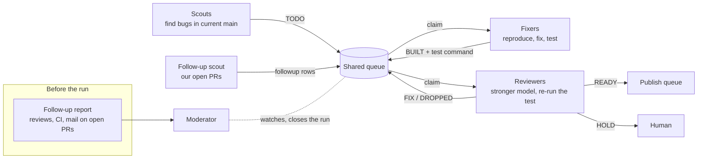

# Case study: the in-house pipeline behind tanda

tanda is the clean, general rewrite of a set of shell scripts I run every day to contribute
fixes to open-source AI tooling. This page describes that in-house system: how it is built,
the rules it runs under, and what the numbers say. It describes the design only; the scripts
themselves stay private.

**Result so far:** 736 pull requests merged by maintainers across 169 repositories since
August 2026, 167 of them in repositories with over 10k stars. The full list is in the
[Merge Log](https://portfolio-alexgonzalez33.vercel.app).

## Roles

One run is a *tanda*: a batch with a target number of new pull requests. Every role is a
coding-agent session with its own prompt and model, and they coordinate only through a shared
queue with a file lock.

| Role | Model tier | What it may do |
| --- | --- | --- |
| Scout (×2) | mid | Search for real bugs; add rows to the queue. No code, no writes to GitHub. |
| Follow-up scout | mid | Turn maintainer reviews, conflicts and red CI on our open PRs into rows. |
| Fixer (×3) | mid | Reproduce the bug in an isolated worktree, fix it, record the exact test command that went red to green. |
| Reviewer (×3) | high | Re-run that test on the fix and on `main`, check value, diff size, duplicates and the PR text; set READY, FIX, DROPPED or HOLD. |
| Moderator | high | Watch the run, unblock stuck rows, write the closing report. |
| Follow-up owner | mid | Own every open PR until it is merged or closed. |

## Queue states

`TODO → CLAIMED → BUILT → REVIEW → READY → PUBLISHED`, with `FIX` (back to a fixer with a
concrete note), `DROPPED`, `PLAN` (a reviewer writes a five-line plan before anyone codes) and
`HOLD` (a human decides). A row cannot reach `BUILT` without the test command that proved the
fix, and roles may only set the states their prompt allows.

## Rules the agents work under

These are policy decisions, each made after looking at what earlier runs produced:

- **Only work maintainers want.** New rows come from issues the team opened, labelled or
  confirmed, or from regressions users hit in current `main`; speculative clean-ups are dropped.
- **Maintained projects first.** New work goes to repositories with an active team behind them
  and to those that already merge this kind of fix. Follow-ups on PRs already open continue
  anywhere until they are merged or closed.
- **Volume caps.** A ceiling of open PRs per repository, lower where a maintainer asked for it,
  and some organisations frozen entirely. Maintainers notice volume before quality.
- **AI policies are respected.** Repositories whose contribution guide rejects AI-assisted
  work are skipped. PR descriptions disclose AI involvement in neutral wording, and on repos
  with a CLA no co-author trailer is added.
- **The reviewer is independent and strict.** It runs on a stronger model than the fixer and
  re-runs the fixer's test itself; a fix without a test that fails on `main` goes back.
- **Mechanical follow-ups skip the reviewer.** Lint, CI and literal changes a maintainer
  requested go straight to READY after a diff check, so reviewer time goes to new logic.

## Measuring it

Each closed run appends a row of metrics: duration, rows by type, rows dropped at triage, new
PRs and follow-ups published, merges, 30-day merge rate, open PRs, sessions, requests, average
context per request, and model cost at API prices.

Over 35 runs between 25 October and 1 November 2026:

| Metric | Value |
| --- | --- |
| New pull requests published | 446 |
| Follow-ups published | 130 |
| 30-day merge rate | 87–89% |
| Model cost per published PR (API prices) | about $2.50–4 |

Decisions the metrics drove:

- **Triage before build.** Building a fix and then dropping it was the most expensive mistake,
  so candidates are verified before a fixer touches them.
- **Reviewers moved to a cheaper model.** A side-by-side test showed nearly the same verdicts
  at about 2.5× lower cost.
- **A third reviewer.** The bottleneck was finished fixes waiting for review, not fixing.
- **Context discipline.** Prompts tell each role exactly which slice of the shared notes to
  read, because average context per request was the main cost driver.

## What tanda keeps from this

The queue, the role verdicts, the review gate, the hold-for-a-human default and the
`oss-contrib` example all come from this system. What stays out of tanda is the
project-specific part: the company registry, the per-repo state and the prompts tuned to my
own targets.
