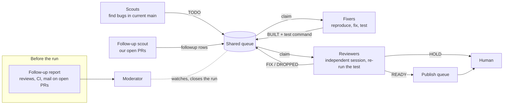

# Case study: the in-house pipeline behind tanda

tanda is the clean, general rewrite of a set of shell scripts I run every day to contribute
fixes to open-source AI tooling. This page describes that in-house system: how it is built,
the rules it runs under, and what the numbers say. It covers the design only; the scripts
themselves stay private.

**Result so far (24 November 2026):** 1,737 pull requests merged by maintainers across 405
repositories since August 2026, 310 of them in repositories with over 10k stars. The full list
is in the [Merge Log](https://portfolio-alexgonzalez33.vercel.app).

**Focus:** the bugs AI tooling keeps hitting. Breakage from LLM provider and API changes,
concurrency bugs in async code, and serialization problems.

**Quality bar:** small changes, a test on nearly every PR, AI involvement disclosed in every PR
description, and a human who decides what to target and what gets published.

## Roles

One run is a *tanda*: a batch with a target number of new pull requests. Every role is a
coding-agent session with its own prompt and model, and they coordinate only through a shared
queue with a file lock.

| Role | Model tier | What it may do |
| --- | --- | --- |
| Scout (×2) | mid | Search for real bugs; add rows to the queue. No code, no writes to GitHub. |
| Follow-up scout | mid | Turn maintainer reviews, conflicts and red CI on our open PRs into rows. |
| Fixer (×2–3) | mid | Reproduce the bug in an isolated worktree, fix it, record the exact test command that went red to green. |
| Reviewer (×1–3) | separate session | Re-run that test on the fix and on `main`, check value, diff size, duplicates and the PR text; set READY, FIX, DROPPED or HOLD. |
| Moderator | high | Watch the run, unblock stuck rows, write the closing report. |
| Follow-up owner | mid | Own every open PR until it is merged or closed. |

The number of sessions follows the run's target. A run aimed at five new PRs or fewer starts two
scouts, two fixers and one reviewer. One run used 13 sessions for a five-PR target, which was far
more than the work needed.

## Queue states

`TODO → CLAIMED → BUILT → REVIEW → READY → PUBLISHED`, plus `FIX` (back to a fixer with a
concrete note), `DROPPED`, `PLAN` (a reviewer writes a five-line plan before anyone codes) and
`HOLD` (a human decides). A row cannot reach `BUILT` without the test command that proved the
fix, and roles may only set the states their prompt allows.

## The review gate

For new logic, the reviewer is the only path to `READY` (mechanical follow-ups take a shorter
path; see Rules below). It is built to be hard to fool:

- **Independent.** An independent reviewer (separate session) that doesn't continue the fixer's
  session. It reads the diff and the draft the way a maintainer would.
- **Evidence over claims.** The fixer has to record the exact test command. The reviewer runs it
  on `main` (where it must fail) and on the fix (where it must pass). A test that passes on both
  proves nothing, so the row goes back as `FIX`.
- **Value and size.** Would a user notice? Is the root cause stated in one sentence? Is the diff
  the smallest one in the repo's own style?
- **Repo rules and text.** CLA/DCO, issue-first requirements, PR template checkboxes that are true
  for this diff, a neutral AI disclosure, no local paths, no claims that the human ran something
  an agent ran. Text problems the reviewer fixes itself. Code problems go back to the fixer.
- **Duplicates.** It searches under the repo's canonical name, because a renamed repo hides
  earlier PRs, including our own.
- **Four exits only:** `READY`, `FIX` with a concrete note, `DROPPED`, or `HOLD` when a person must
  decide.

In tanda, the code enforces the structure of this gate: only the reviewer role may set `READY`,
and only on an item it holds. The checks themselves live in the reviewer prompt
(`tanda/examples/oss-contrib/prompts/reviewer.md`).

## Human in the loop

Agents do the searching, reproducing, fixing and checking. A person keeps the decisions that
carry reputational risk:

| Decision | Who | Why |
| --- | --- | --- |
| Which repos and orgs are in scope | Human | Volume caps, frozen orgs and AI policies are relationship decisions, not technical ones. |
| Whether a candidate is worth building | Human, or a triage role the human watches | Dropping a candidate after a build was the most expensive mistake. |
| Design choices and behavior changes | Human, through `HOLD` | The fixer drafts an issue comment instead of code, and the human decides whether to post it. |
| Publishing a PR | Agents, inside fixed rules | Per-repo caps and frozen orgs apply, an independent reviewer re-runs the test before anything is published, and AI involvement is disclosed on every PR. |

`HOLD` is the default for anything unexpected: an agent that exits without a verdict, a timeout, a
repro only the human can observe, or a CLA that assigns copyright or grants an exclusive license
(license-only CLAs are signed under a standing rule). Parking an item costs minutes of human time.
A wrong PR costs a maintainer's trust.

## Rules the agents work under

These are policy decisions, each made after looking at what earlier runs produced:

- **Only work maintainers want.** New rows come from issues the team opened, labelled or
  confirmed, or from regressions users hit in current `main`. Speculative clean-ups are dropped.
- **Maintained projects first.** New work goes to repositories with an active team behind them
  and to those that already merge this kind of fix. Follow-ups on PRs already open continue
  anywhere until they are merged or closed.
- **Volume caps.** A ceiling of open PRs per repository, lower where a maintainer asked for it,
  and some organisations frozen entirely. Maintainers notice volume before quality.
- **AI policies are respected.** Repositories whose contribution guide rejects AI-assisted
  work are skipped. PR descriptions disclose AI involvement in neutral wording, and on repos
  with a CLA no co-author trailer is added.
- **The reviewer is independent and strict.** It runs as a separate session and
  re-runs the fixer's test itself. A fix without a test that fails on `main` goes back.
- **Mechanical follow-ups skip the reviewer.** Lint, CI and literal changes a maintainer
  requested go straight to READY after a diff check, so reviewer time goes to new logic.

## Measuring it

Each closed run appends a row of metrics: duration, rows by type, rows dropped at triage, new
PRs and follow-ups published, merges, 30-day merge rate, open PRs, sessions, requests, average
context per request, and model cost at API prices.

Over 35 runs between 25 October and 1 November 2026:

| Metric | Value |
| --- | --- |
| New pull requests published | 446 |
| Follow-ups published | 130 |
| 30-day merge rate | 87–89% |
| Model cost per published PR (API prices) | about $2.50–4 |

Decisions the metrics drove:

- **Triage before build.** Building a fix and then dropping it was the most expensive mistake,
  so candidates are verified before a fixer touches them.
- **The reviewer's model is chosen by testing.** In a side-by-side test, two reviewer models gave
  nearly the same verdicts at about a 2.5× cost difference.
- **A third reviewer.** The bottleneck was finished fixes waiting for review, not fixing.
- **Context discipline.** Prompts tell each role exactly which slice of the shared notes to
  read, because average context per request was the main cost driver.

## Cost control

Cost here is mostly a design problem, not a pricing problem. These are the levers used (the list
isn't ranked):

1. **Don't build what you'll drop.** Verification and triage come before any fixer session.
2. **No idle sessions.** Waiting happens in the orchestrator. An agent exists only while it holds
   a row, and dry scout passes put the scouts to sleep instead of letting them search again.
3. **Size the fleet to the target.** The session count follows the run's PR target (see Roles).
4. **Small context.** Each role reads only its slice of shared notes. Headless roles start without
   the memory index, connectors or skills they don't use (see below).
5. **Model per role.** Each role's model is chosen separately, and changed only after a
   side-by-side test of its verdicts.
6. **Hard ceilings.** A dollar cap per queue row in-house. In tanda, a time ceiling per run
   (`max_hours`).
7. **Measure at billed prices.** Cost is read from transcripts, with cache reads and writes priced
   the way they are billed.

tanda keeps levers 2, 5 and the time ceiling. Per-row dollar caps and transcript-based cost
reports are in-house only for now (see [roadmap](roadmap.md)).

## What changed after the first month

The pipeline kept running while I measured it. These are the changes since the numbers above,
each one a reaction to something the metrics or the maintainers showed.

- **Repositories are ordered by how they respond.** A repository with more than three times as
  many open PRs of mine as merges in the last 30 days goes behind the others when a fixer claims
  work. The trigger was one project with eight of my PRs open and two merged.
- **The run knows when it is out of work.** When every scout has finished, the queue has no
  candidates left and new plus in-progress PRs are still under the target, the run exits with a
  specific code instead of waiting for work that will not come.
- **Dry scout passes pause the run.** Three scout passes in a row that add nothing put the
  scouts to sleep for 30 minutes, so an empty search space costs time instead of tokens.
- **Headless roles start light.** Fixers, reviewers, scouts and the mail and watch roles run
  non-interactively and now start without the memory index, connectors or skills they never
  use (the reviewer keeps its skills), with a prompt cache of five minutes and a cap in dollars
  per queue row. In a test the fixed prefix of a session went from 34,465 to 10,709 tokens.
- **The moderator compacts less often.** Its auto-compaction threshold went from 100k to 200k
  tokens, because at 100k it compacted about every four requests. The run now warns when the
  moderator's context passes 220k tokens per request.
- **Cost is read from the transcripts, at real prices.** A day on 21 November came to about
  $2.30 per published PR once cache reads and writes are priced as they are billed. That is the
  number the light start is meant to bring down.

## What tanda keeps from this

| In-house system | In tanda v0.1 |
| --- | --- |
| Shared queue with a lock | SQLite queue with atomic claims (WAL, `BEGIN IMMEDIATE`) |
| Role verdicts | `claims` / `working` / `verdicts` per role, enforced by the CLI |
| Independent review gate | Reviewer role + `oss-contrib` reviewer prompt |
| HOLD for a human by default | Automatic `HOLD` on exit without a verdict or timeout |
| Volume caps, frozen orgs | `group_cap`, `blocked_groups`, dedup on group + ref |
| No idle sessions | Agents start only when there is an item for them |
| Moderator, follow-up scout and owner, `PLAN` state | Not included |
| Per-run metrics, cost per PR, dollar caps per row | Not included yet |
| Repo registry, per-repo state, tuned prompts | Private |

---

## Next case studies (outlines)

These are drafts for short write-ups of patterns that keep coming up in the merge log. Each one
should link 3–5 real merged PRs from the [Merge Log](https://portfolio-alexgonzalez33.vercel.app)
and include no numbers the log doesn't support.

### A. When the provider changes under you: model and API drift

- **Pattern.** A provider retires a model, renames a parameter, adds a finish reason or changes a
  streaming event. The SDK wrapper or adapter still works for the common path but quietly drops,
  mismaps or swallows the new case.
- **How the scout finds it.** Compare each provider adapter with its siblings in the same repo:
  parameters that get dropped, finish reasons and usage mapped wrong, stream errors swallowed,
  defaults pointing at retired models. This comes from the `oss-contrib` scout prompt.
- **What the fix looks like.** A small mapping or default change, plus a test that feeds in the
  new response shape.
- **Review-gate angle.** The test has to fail against the current mapping, not just assert the
  new constant.
- **Links:** [2–3 merged PRs: retired-model defaults] · [1–2: finish-reason or usage mapping]

### B. Async concurrency and serialization in AI tooling

- **Pattern (concurrency).** Shared mutable state across `async` tasks, missing locks around
  client caches, cancellation that leaks a stream or leaves a half-written state.
- **Pattern (serialization).** `to_dict` / `model_dump` round-trips that lose fields, non-JSON
  types (datetimes, enums, bytes) in tool-call payloads, Pydantic v1/v2 differences.
- **Why agents are good at it.** The bug can be reproduced in a small test: run two tasks with a
  fixed interleaving, or round-trip an object and compare.
- **What makes it hard.** Flaky reproductions. The reviewer should reject tests that only fail
  sometimes, and fixers should make the interleaving deterministic.
- **Links:** [2–3 merged PRs: async race or cancellation] · [2–3: serialization round-trip]
